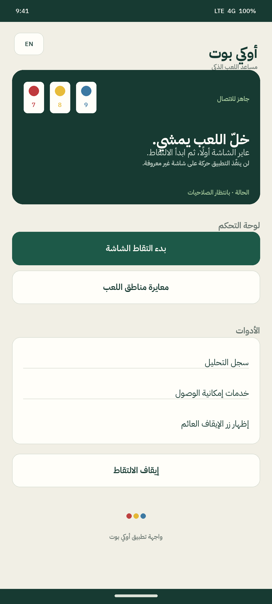

# OkeyBot

مشروع أندرويد تجريبي بلغة Kotlin للعبة Okey. يتضمن محلّلًا مستقلًا لقواعد اللعبة ووحدة أندرويد لالتقاط الشاشة والمعايرة وإيماءات إمكانية الوصول.

## تنزيل APK على الهاتف

**تنزيل مباشر:** [OkeyBot-debug.apk](https://github.com/jdjj47090-sketch/okeybot-android/releases/download/v0.1.0-demo/app-debug.apk) من [الإصدار التجريبي](https://github.com/jdjj47090-sketch/okeybot-android/releases/tag/v0.1.0-demo). نزّل الملف على الهاتف وثبّته؛ قد يطلب Android السماح بالتثبيت من هذا المصدر.

بعد كل رفع للمصدر، ينفّذ GitHub Actions اختبارات الدماغ ويبني APK جديدًا. يمكن تنزيل أحدث بناء من تبويب **Actions** في المستودع عبر artifact باسم `OkeyBot-debug-apk`.

## البناء محليًا

يتطلب JDK 21 وAndroid SDK Platform 35:

```sh
./gradlew :brain:test
./gradlew assembleDebug
```

## معاينة الواجهة



تتضمن الواجهة تبديلًا محفوظًا بين العربية والإنجليزية، ولوحة تشغيل واضحة، وشاشات معايرة وسجل محدثة.

## إعداد التطبيق

1. عند التشغيل، وافق على الإشعارات واسمح بالظهور فوق التطبيقات.
2. فعّل خدمة OkeyBot من إعدادات إمكانية الوصول، ثم ارجع للتطبيق.
3. وافق على نافذة مشاركة الشاشة. إذا ألغيت أي إذن أو رجعت دون تفعيله، يغلق التطبيق نفسه.
4. بعد اكتمال الصلاحيات، اترك اللعبة ظاهرة ليحللها الالتقاط، ثم ارجع إلى OkeyBot. في المعايرة اختر **ركني الرف** ثم المس الركن العلوي والسفلي لاحتواء صف القطع والقطع الإضافية فوقه. لاختيار كومة السحب أو الرمي أو المؤشر، اضغط زر المنطقة ثم المس وسطها في اللقطة. تظهر المناطق المحفوظة بألوان مختلفة؛ يمكنك تعديل أي منها بإعادة تحديدها. اقتراح الرف/السحب التلقائي قابل للمراجعة والحفظ من الزرين أسفل المعاينة.

## اللوحة العائمة

بعد بدء الالتقاط تظهر فقاعة **أوكي** فوق اللعبة. اسحبها إلى أي مكان واضغطها لفتح لوحة التحكم: بدء الالتقاط (يعرض موافقة Android عند الحاجة)، إيقاف مؤقت/استئناف، إيقاف فوري، فتح المعايرة، أو سجل التحليل. زر الإغلاق يصغّر اللوحة إلى الفقاعة؛ وتبقى الفقاعة بعد إيقاف الالتقاط لتسمح ببدء جلسة جديدة.

## الحالة الحالية

اختبارات الدماغ تمر. يستخدم OpenCV حدود القطع الفاتحة لاقتراح صفوف الرف، بما فيها الصف الإضافي فوق الرف، ويرجّح كومة السحب الطويلة في تخطيط لعبتك. كما يمكن تحديد حدود الرف بركنين ومراكز السحب والرمي والمؤشر يدويًا. تبقى الاقتراحات هندسية أولية؛ لا يقرأ التطبيق أرقام القطع أو ألوانها ولا يحدد حالة الدور تلقائيًا بعد. يبقى التنفيذ متوقفًا عند الشاشة غير المعروفة ولا تصدر نقرات اللعب حتى يكتمل التعرف على البلاطات والحالات.
